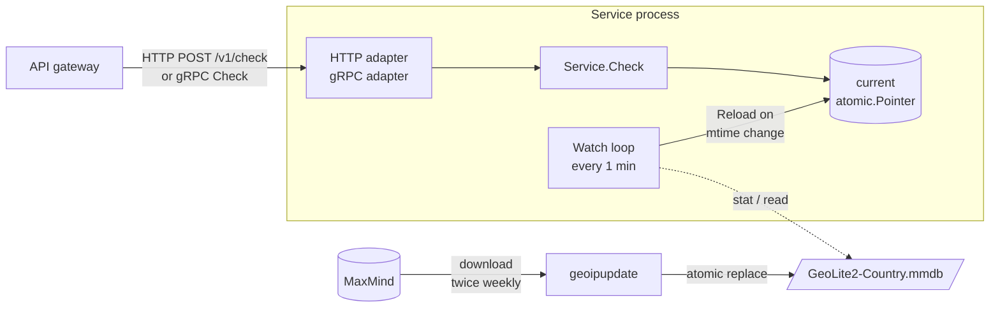
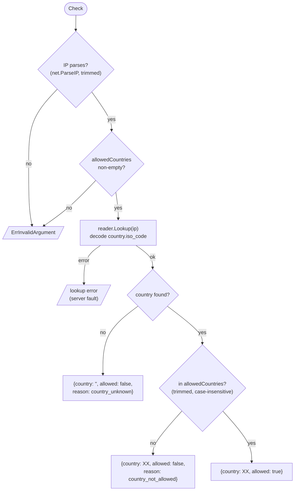
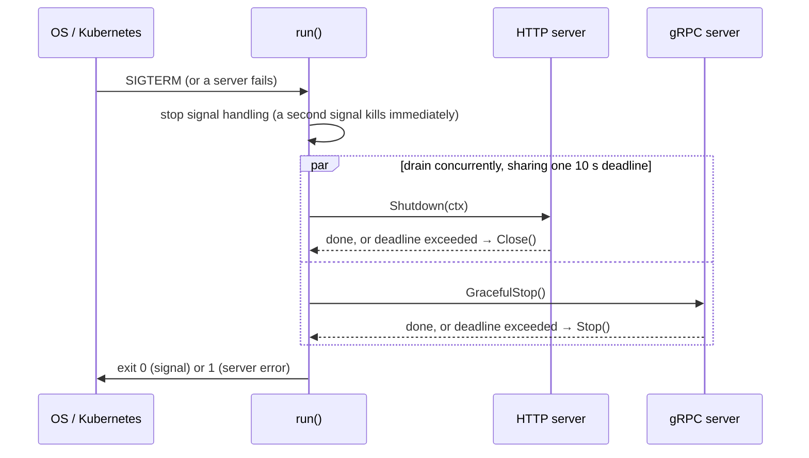
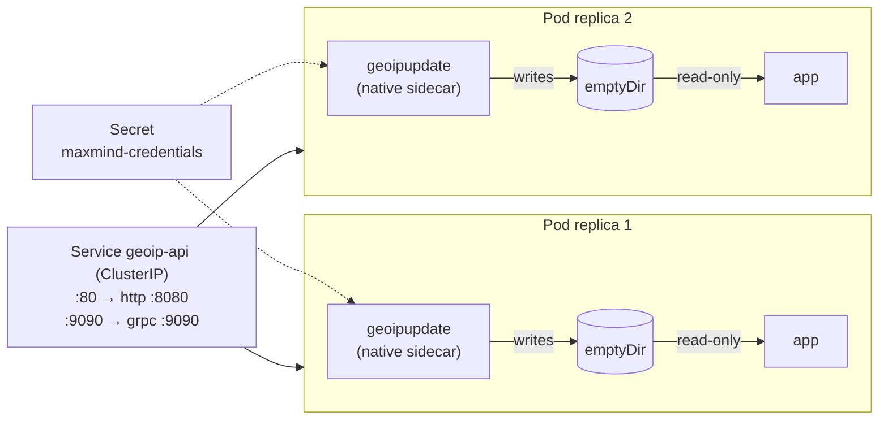

# Low-Level Design: IP Country Check Service

| | |
|---|---|
| **Status** | Implemented (phase one). Written retroactively to describe the code as built |
| **Code** | [cmd/server](../cmd/server), [internal/iplookup](../internal/iplookup), [proto](../proto) |
| **Related** | [README](../README.md) (usage and API reference), [GeoIP database updates](geoip-database-updates.md) (operations) |

## 1. Context and scope

Customers want to restrict which countries their users can log in to their UI accounts from, so that work can't be quietly outsourced elsewhere. The agreed design splits the work:

- **The customer database** stores each customer's allowed countries.
- **The API gateway** captures the requesting IP, looks up the target customer's restrictions, and calls this service.
- **This service** answers one question: *is this IP address in one of these countries?*

The service is stateless with respect to customers. It holds no customer data and makes no policy decisions beyond the country check itself.

**In scope:** IPv4 and IPv6 lookups, the HTTP and gRPC APIs, keeping the IP data current, and deployment to Docker and Kubernetes.

**Out of scope (phase one):** VPN and proxy detection (the presented IP is taken at face value), storing per-customer configuration, and authentication (the service is cluster-internal and called only by the gateway).

## 2. Architecture



Two independent paths share one piece of state, the `current` pointer:

- **Request path:** a request enters through a protocol adapter, is validated and resolved in `Service.Check`, and reads whichever database `current` points to.
- **Data path:** geoipupdate replaces the file on disk; the `Watch` loop notices, loads the new file, and swaps `current`.

Neither path blocks the other.

## 3. Code structure

```
cmd/server/main.go          process wiring: config, listeners, both servers, signals, shutdown
internal/iplookup/
  api.go                    Service: Check, Reload, Watch, DatabaseBuild; Result and Reason types
  http.go                   HTTP adapter: routes, JSON encoding, error-to-status mapping
  grpc.go                   gRPC adapter: generated-interface implementation, health, reflection
  testdata/                 MaxMind's test database
proto/iplookup/v1/          gRPC contract (source of truth for gen/)
gen/iplookup/v1/            generated Go code (committed, regenerated with buf)
deploy/                     Dockerfile and Kubernetes manifest
```

`Service` contains all the logic and knows nothing about transports. The HTTP and gRPC adapters are thin: each decodes a request, calls `Service.Check`, and maps the result or error onto its protocol. Adding a third transport, or calling the service as a Go library, needs no change to `Service`.

## 4. Core component: `Service`

### 4.1 Types

```go
type Service struct {
    dbPath  string
    current atomic.Pointer[loadedDB] // swapped on reload, never nil after New
}

type loadedDB struct {
    reader  *maxminddb.Reader // queries the in-memory database
    modTime time.Time         // file modification time, to detect replacement
}

type Result struct {
    Country string // ISO 3166-1 alpha-2, or "" if unknown
    Allowed bool
    Reason  Reason // "" when allowed
}

type Reason string // "country_not_allowed" | "country_unknown"

var ErrInvalidArgument = errors.New("invalid argument") // wraps all validation failures
```

### 4.2 `Check(ip, allowedCountries)`



Points to note:

- **A denial is a result, not an error.** Errors mean no decision could be made: either the input was invalid, or the lookup itself failed.
- **"Not found" is not a lookup error.** The MaxMind reader returns no error for addresses it has no data for (private and reserved ranges, or the roughly 2,000 networks MaxMind can't place). The record decodes empty, and `Check` returns `country_unknown`.
- **Only `country` is decoded.** The record also has `registered_country`, where the network's owner registered it, which is often not where the user is. It is deliberately not used as a fallback (see [section 10](#10-design-decisions)).
- **Lookups are cheap:** about 330 ns and zero heap allocations each, measured against the full GeoLite2-Country database. The service is not CPU-bound at any realistic gateway load.

### 4.3 Data structure

The `.mmdb` file is a binary search tree keyed on IP address bits, followed by a data section. The current GeoLite2-Country database:

| | |
|---|---|
| File size | 3.4 MB |
| Tree nodes | ~547,000 |
| Networks | ~1,065,000 (563k IPv4, 502k IPv6) |
| Load time (read + open) | ~1 ms |

A lookup walks at most 32 (IPv4) or 128 (IPv6) bits down the tree to a pointer into the data section. Records are deduplicated, so every network in a country shares one record. IPv4 addresses live inside the IPv6 tree, so both families, including IPv4-mapped IPv6 (`::ffff:8.8.8.8`), use the same path.

The reader queries this structure directly from memory with no up-front decoding. For comparison, decoding every network into a Go `map[network]country` used about 108 MB of heap, roughly 30 times as much, and still couldn't answer the longest-prefix-match question without extra work.

### 4.4 Loading and reloading

`Reload` is used both by `New` (initial load) and by `Watch` (refresh):

1. `stat` the file. If its modification time equals the loaded copy's, return; nothing changed.
2. Read the whole file into a byte slice and open it with `maxminddb.FromBytes`, which validates the metadata.
3. Store a new `loadedDB` in `current` with a single atomic pointer write.
4. Log `Loaded database <path> (built <build date>)`.

If any step fails, `current` is left untouched and the error is returned. `New` turns that into a startup failure; `Watch` logs it and tries again on the next tick.

`Watch` runs `Reload` on a one-minute ticker until its context is cancelled at shutdown.

### 4.5 Concurrency model

| Concern | How it's handled |
|---|---|
| Lookups during a reload | Each lookup does one atomic `Load` of `current` and uses that `loadedDB` throughout. A lookup that started before a swap finishes on the old copy; later lookups see the new one. No lock is held anywhere |
| Freeing the old database | Old readers are never closed. Because the data is a heap byte slice rather than a memory map, the garbage collector frees it once the last in-flight lookup drops its reference |
| Partial or torn data | `current` only ever points to a fully opened reader. geoipupdate writes to a temporary file and renames it, so `Reload` never reads a half-written file |
| `current` being nil | Impossible after `New` returns. `New` fails unless the first load succeeds, and `Reload` never stores nil. `Check` and `DatabaseBuild` rely on this invariant, so a zero-value `Service{}` is not usable |
| Memory | One database (~3.4 MB) at steady state. Briefly two during a reload, while in-flight lookups finish |

## 5. API contracts

Both protocols expose the same operation with the same semantics. The `.proto` file is the canonical schema for gRPC; the README has full request and response examples.

### 5.1 HTTP

| Route | Request | Success response |
|---|---|---|
| `POST /v1/check` | `{"ip": string, "allowed_countries": [string]}` | `200 {"country", "allowed", "reason"?}` |
| `GET /health` | | `200 {"status": "ok", "database_build": RFC 3339}` |

Request handling:
- The body is capped at 64 KB.
- Unknown JSON fields are rejected, so a misspelled field fails loudly instead of being silently ignored.
- `reason` is omitted from the JSON when the IP is allowed.

### 5.2 gRPC

| Method | Notes |
|---|---|
| `iplookup.v1.IPLookupService/Check` | `CheckRequest{ip, allowed_countries}` → `CheckResponse{country, allowed, reason}`. `reason` is an enum whose zero value, `REASON_UNSPECIFIED`, means allowed |
| `grpc.health.v1.Health/Check` | Standard health service; reports `SERVING` while the process is up |
| Server reflection | Enabled, so tools such as grpcurl can discover the API without the `.proto` file |

### 5.3 Error and reason mapping

| Outcome in `Service.Check` | HTTP | gRPC | Logged |
|---|---|---|---|
| Allowed | `200`, no `reason` | `OK`, `REASON_UNSPECIFIED` | No |
| Country not in list | `200`, `country_not_allowed` | `OK`, `REASON_COUNTRY_NOT_ALLOWED` | No |
| Country unknown | `200`, `country_unknown` | `OK`, `REASON_COUNTRY_UNKNOWN` | No |
| Malformed JSON body | `400` | n/a | No |
| `ErrInvalidArgument` (bad IP, empty list) | `400` with message | `INVALID_ARGUMENT` with message | No |
| Any other error (lookup failure) | `500 {"error": "lookup failed"}` | `INTERNAL`, `lookup failed` | Yes, with details |

Client errors return a descriptive message and aren't logged, since they're the caller's problem. Server errors return a generic message to avoid leaking internals, and log the full error for operators.

### 5.4 Validation rules

| Input | Rule |
|---|---|
| `ip` | Must parse as IPv4 or IPv6 after trimming whitespace |
| `allowed_countries` | Must be non-empty. Entries are trimmed and compared case-insensitively. Their format is not yet validated, so a malformed code (e.g. `"USA"`) never matches rather than being rejected (see [section 11](#11-known-limitations-and-future-work)) |

## 6. Process lifecycle

### 6.1 Configuration

All configuration comes from environment variables, with defaults suited to local development:

| Variable | Default |
|---|---|
| `DB_PATH` | `data/GeoLite2-Country.mmdb` |
| `ADDR` | `:8080` (HTTP) |
| `GRPC_ADDR` | `:9090` (gRPC) |

### 6.2 Startup

1. Read configuration.
2. Load the database (`iplookup.New`). On failure, exit with an error.
3. Install handlers for SIGINT and SIGTERM, and start the `Watch` loop.
4. Open both listeners up front, so a bad or in-use port fails startup immediately rather than surfacing later.
5. Start the HTTP and gRPC servers in their own goroutines.

### 6.3 Shutdown



Points to note:
- **Both servers drain at the same time**, so they share the 10-second budget rather than one consuming it before the other starts.
- **gRPC has a fallback.** `GracefulStop` has no deadline of its own, so it falls back to a forced `Stop` when the budget runs out.
- **The `Watch` loop stops** via the same signal context.

### 6.4 Server timeouts

| Setting | Value | Purpose |
|---|---|---|
| `ReadHeaderTimeout` | 5 s | Limit slow header delivery |
| `ReadTimeout` | 10 s | Limit slow body delivery, which `ReadHeaderTimeout` doesn't cover |
| `IdleTimeout` | 2 min | Keep the gateway's pooled keep-alive connections. Without it, Go falls back to `ReadTimeout`, which would drop them after 10 s idle |
| `WriteTimeout` | none | Responses are tiny and the handler takes microseconds, so there is nothing to protect |
| Shutdown drain | 10 s | Within Kubernetes' default 30 s termination grace period |

## 7. Data management

The [GeoIP database updates](geoip-database-updates.md) guide covers setup and operations. In summary:

- **Source:** MaxMind GeoLite2-Country, released twice a week.
- **Updater:** MaxMind's geoipupdate, run as a sidecar in Kubernetes or inside the container's entrypoint in plain Docker. It replaces the file atomically.
- **Propagation:** the `Watch` loop picks up a new file within one minute, with no restart and no failed requests.
- **Failure handling:** a failed download or reload leaves the last good data in service, and both are logged.
- **Freshness reporting:** the database build date is logged on every load and reported by `/health`.
- **Licence constraints:** the database can't be redistributed, so it isn't committed, and each environment downloads its own copy. Old copies must be deleted within 30 days of a new release, which in-place replacement satisfies. MaxMind must be credited.

## 8. Observability

### 8.1 Logs

Logs are plain text on stderr, written with Go's standard `log` package.

| Message | Level of concern | Meaning |
|---|---|---|
| `Loaded database <path> (built <date>)` | Info | Startup load or successful refresh |
| `HTTP listening on ...` / `gRPC listening on ...` | Info | Servers started |
| `Error reloading database: ...` | Warning | Refresh failed; previous data still in use |
| `Error checking IP: ...` | Error | A lookup failed; the caller got `500` / `INTERNAL` |
| `Error writing response: ...` | Warning | The client disconnected mid-response |
| `Shutdown signal received...` / `Shutdown complete` | Info | Graceful shutdown |
| `Shutting down after server error: ...` | Error | A server failed; the process will exit non-zero |

Successful checks aren't logged, so per-request IPs, which are personal data, don't end up in the logs.

### 8.2 Health and alerting

| Check | Used by | Behaviour |
|---|---|---|
| `GET /health` | Kubernetes liveness and readiness probes | Always `200` while the process is serving |
| `grpc.health.v1.Health` | gRPC-aware load balancers and tools | Always `SERVING` while the process is serving |

A single health endpoint serves both probes, because liveness and readiness can't differ for this service. It won't start without data, and never loses data once running.

Stale data is surfaced through `database_build` rather than by failing the health check. Every replica would go stale at once, so failing the check would turn a data-freshness problem into a full outage. The recommended alert is `database_build` older than about 7 days.

## 9. Deployment

### 9.1 Container image

[deploy/Dockerfile](../deploy/Dockerfile) is a two-stage build:

1. **Build stage:** `golang:1.27` compiles a static binary (`CGO_ENABLED=0`).
2. **Runtime stage:** based on MaxMind's geoipupdate image. A generated entrypoint script downloads the database once (and exits if that fails), starts a background refresh loop, then `exec`s the service binary.

Credentials are passed at runtime, never baked into the image.

### 9.2 Kubernetes

[deploy/k8s/deployment.yaml](../deploy/k8s/deployment.yaml):



| Aspect | Setting |
|---|---|
| Replicas | 2 |
| Startup ordering | The sidecar's `startupProbe` (database file exists) must pass before the app starts. Native sidecars require Kubernetes 1.29+ |
| App command | `/app`, bypassing the image's built-in updater because the sidecar does that job |
| Probes | Liveness and readiness both on `GET /health` |
| Resources | Requests 100m CPU / 128 Mi; limits 500m CPU / 512 Mi |

## 10. Design decisions

| Decision | Alternatives considered | Rationale |
|---|---|---|
| Read the database into memory (`FromBytes`) | Memory-map the file (`Open`) | geoipupdate replaces the file underneath the process. With a memory map, the old mapping must be kept alive and closed carefully, and behaviour on network volumes is unreliable. A 3.4 MB heap copy has none of those problems |
| Query the `.mmdb` tree directly | Decode into a Go map or range table | The tree already provides longest-prefix match in ~330 ns with no allocations. A map used ~108 MB, roughly 30 times as much, and couldn't do prefix matching by itself |
| Hot reload via mtime polling | Restart pods on new data; filesystem notifications; SIGHUP | Polling is simple, portable, and works on network storage. A restart costs a rollout and a fresh MaxMind download per pod. One minute of latency on twice-weekly data doesn't matter |
| Atomic pointer swap, no locks | `sync.RWMutex` | Lookups never wait, even during a reload, and the code is smaller |
| Fail startup if the database can't load | Start, and report not-ready until loaded | This makes "no database" impossible at runtime, which removes a whole error path (`503` / `UNAVAILABLE`) and lets health be a constant |
| Denial is a result; errors are for failures | Return "not allowed" on lookup errors | A corrupt database returning `allowed: false` would lock out every restricted customer while looking like normal traffic. An error is visible and alertable, and the gateway can decide whether to fail open or closed |
| `reason` only on denials | Always set, including `allowed` | An allowed result needs no explanation. Customers want the reason for their logs when someone is blocked |
| Separate `reason` field | `"UNKNOWN"` sentinel in `country` | Keeps `country` a pure ISO code, so consumers that log or group by country don't need to special-case it |
| Ignore `registered_country` | Fall back to it when `country` is empty | It records where the network's owner registered it, not where the user is. Cloudflare's `1.1.1.0/24`, for example, is registered in Australia. Denying "unknown" is safer than guessing |
| One health endpoint | Separate `/healthz` and `/readyz` | Liveness and readiness can't differ for this service, so two endpoints would always agree |
| Stale data doesn't fail health | Fail readiness when data is old | All replicas would go stale together and take the service down. Report it and alert on it instead |
| Validation lives in `Service.Check` | Validate in each adapter | One set of rules for both protocols. Adapters only map `ErrInvalidArgument` to their client-error code |
| gRPC reflection enabled | Require the `.proto` file | Easier debugging with grpcurl and Postman. The schema isn't sensitive and the port is cluster-internal |
| Commit generated gRPC code | Generate at build time | Builds need neither buf nor network access. The `.proto` stays the source of truth |
| Tests use MaxMind's test database | Real GeoLite data | The real database can't be redistributed, and live data changes over time. The test database is freely licensed and has fixed records |

## 11. Known limitations and future work

| Item | Notes |
|---|---|
| Country-code format validation | Planned: reject entries that aren't two letters with `ErrInvalidArgument`, so a malformed customer configuration fails loudly instead of silently never matching |
| VPN and proxy detection | Out of scope for phase one. Would need a different data source, such as MaxMind's anonymous IP database |
| Metrics | No Prometheus endpoint yet. Candidates: requests by outcome and reason, latency, reload failures, and data age |
| Structured logging | Logs are plain text. Moving to `log/slog` with JSON output would make them easier to query |
| gRPC load balancing | gRPC holds long-lived HTTP/2 connections, so a ClusterIP Service balances per connection, not per request. With many gateway instances this evens out; otherwise use a headless Service with client-side balancing |
| Pinning the updater image | The Dockerfile's runtime stage uses `geoipupdate:latest`, while the Kubernetes sidecar pins `v8.0.0`. Pinning both makes builds reproducible |
| Pod hardening | Add a `securityContext` (non-root, read-only root filesystem, dropped capabilities) and a PodDisruptionBudget |
| MaxMind download limits at scale | Each pod's sidecar downloads independently. Many replicas should switch to a single CronJob writing to shared storage, as described in the updates guide |
